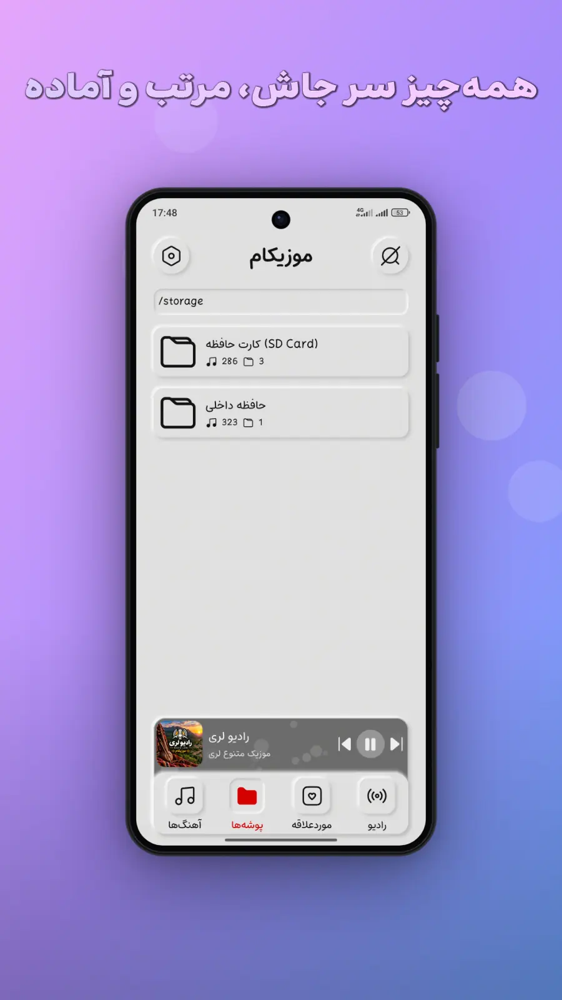
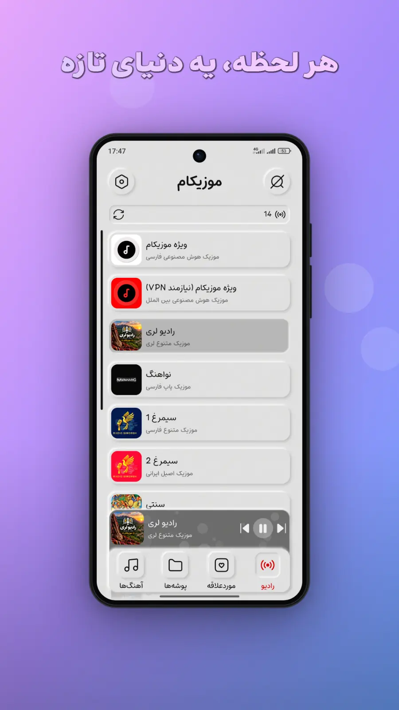
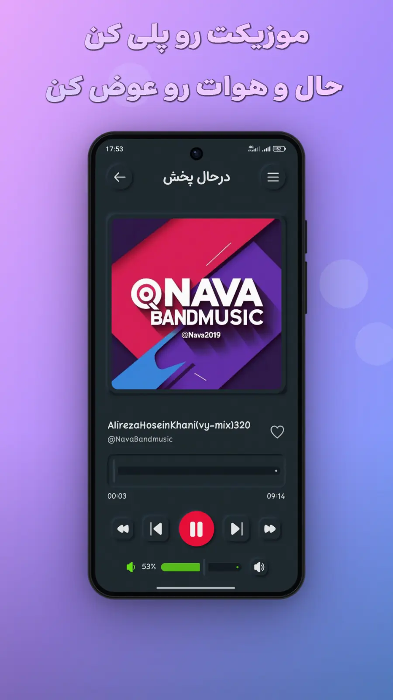
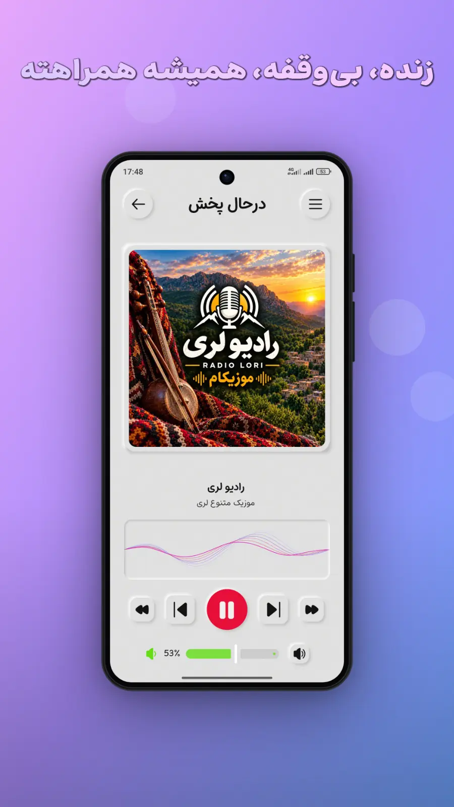
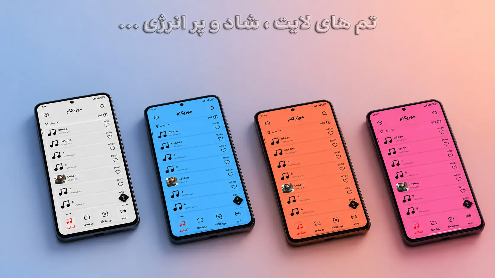
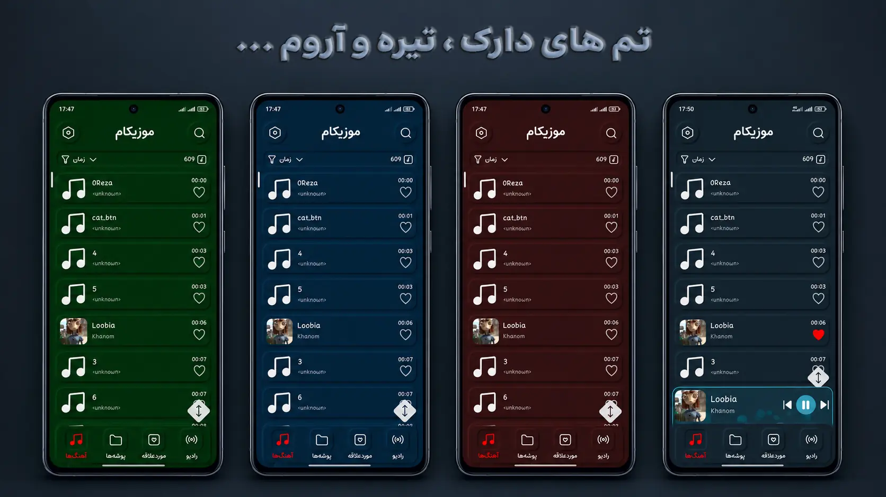

# 🎵 Musicam

**Musicam** is a modern Android music player designed to provide a beautiful, customizable, and enjoyable music listening experience.

With its Neumorphic UI design, customizable themes, and powerful playback features, Musicam makes listening to your favorite music more enjoyable.

  

  

## 📱 Screenshots

### Main Screens

  
  
  
  

### Additional Screens

  
  

## ✨ Features

- 🎧 Play your favorite music
- 📁 Browse and manage music folders
- ❤️ Add songs to your favorites
- 📻 Listen to radio
- 📱 Home screen music widget
- 🔔 Media playback notifications with music controls
- ⏱️ Sleep timer to automatically stop playback
- 🔆 Keep screen on while using the app
- 🔊 Background music playback
- 📂 Play audio files directly from your device
- ⚙️ Customizable settings and playback experience

## 🎨 Design & Customization

- Neumorphic UI design (Neumorphism)
- Modern, clean, and intuitive interface
- Dark and Light themes
- Multiple accent colors for both Dark and Light themes
- Customizable appearance to match your personal style

## 🏗️ Architecture

Musicam is built using the **MVVM (Model-View-ViewModel)** architectural pattern to maintain a clean separation of concerns and improve code organization.

- **MVVM Architecture** – Separates UI, business logic, and data handling.
- **Koin** – Dependency Injection for managing dependencies.
- **Navigation Compose (NavHost)** – Handles navigation between app screens.

## 🛠️ Built With

- Kotlin
- Jetpack Compose
- Android Media3
- Navigation Compose
- Koin
- Kotlin Coroutines
- Material Design

## 📥 Download

Download Musicam from your favorite Android app store:

  

  

Get the latest version of Musicam:

[**Download Musicam APK**](#)

<!-- Replace # with your actual GitHub Releases link -->

## 📋 Requirements

- Android device
- Android version compatible with the released APK

## 👨‍💻 Developer

Developed with ❤️ by the Musicam team.

---

**Musicam – Your Music, Your Experience.** 🎶

